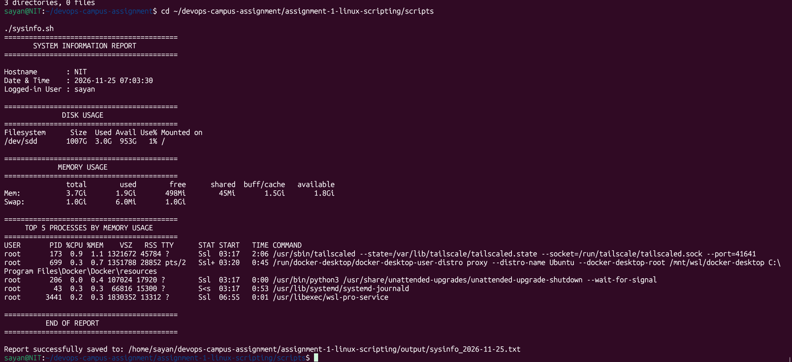
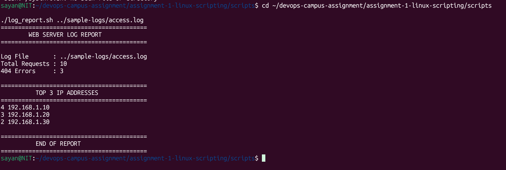
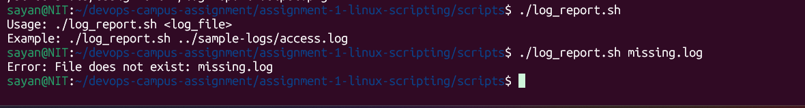

# Assignment 1: Linux Shell Scripting and Git

## 1. Objective

The objective of this assignment is to demonstrate practical knowledge of Linux command-line operations, Bash shell scripting, system monitoring, log analysis, and Git-based version control.

Two Bash scripts are developed:

- **sysinfo.sh:** Collects and displays essential Linux system information, including hostname, date and time, logged-in user, disk usage, memory usage, and top 5 processes by memory consumption.
- **log_report.sh:** Analyzes a web server access log file to calculate total requests, count HTTP 404 errors, and identify the top 3 IP addresses.

Additional features include date-based system reports, input validation, and automated execution using cron.

## 2. Technologies and Tools Used

| Technology                       |                        Purpose 
|-----------|                                               -----------|
| Ubuntu 24.04 (WSL2)                                       Linux development environment |
| Bash                                                      Shell scripting |
| Linux utilities                                           System monitoring and log analysis |
| Git                                                       Version control |
| GitHub                                                    Source code hosting |

## 3. Project Structure

```text
assignment-1-linux-scripting/
│
├── scripts/
│   ├── sysinfo.sh
│   └── log_report.sh
│
├── sample-logs/
│   └── access.log
│
├── output/
│
└── README.md
```

## 4. Environment Setup and Verification

The project was developed and tested using Ubuntu 24.04 running through Windows Subsystem for Linux (WSL2).

The following tools were verified:

- Ubuntu terminal and Linux command execution.
- Git installation and global user configuration.
- Docker installation and Linux container engine connectivity.

 ## Task 1: System Information Script (`sysinfo.sh`)

### Objective

Create a Bash script that collects important Linux system information and displays it in the terminal. The script also saves the generated report in a date-named text file.

### Information collected

The script displays:

- **Hostname:** Uses `hostname` to display the system's hostname.
- **Date and time:** Uses `date` to display the current date and time.
- **Logged-in user:** Uses `whoami` to display the current user.
- **Disk usage:** Uses `df -h /` to display disk usage of the root filesystem in human-readable format.
- **Memory usage:** Uses `free -h` to display RAM and swap usage.
- **Top 5 processes:** Uses `ps aux --sort=-%mem | head -n 6` to display the five processes consuming the most memory. The first line is the column header.

### Implementation

**Script location:** `scripts/sysinfo.sh`

The script uses a Bash function to generate the report. It uses `tee` to display the report in the terminal and save the same output to a file.

The report is automatically saved in the `output/` directory with the current date in its filename.

**Example output filename:**

```text
output/sysinfo_2026-11-24.txt
```

### How to execute

From the Assignment 1 directory:

```bash
cd assignment-1-linux-scripting/scripts
chmod +x sysinfo.sh
./sysinfo.sh
```

To view the generated report:

```bash
cat ../output/sysinfo_$(date +%Y-%m-%d).txt
```

### Testing and verification

The script was executed successfully in Ubuntu on WSL2.

The following checks were verified:

- System hostname and logged-in username were displayed.
- Current date and time were displayed.
- Root filesystem disk usage was displayed.
- RAM and swap usage were displayed.
- Exactly five processes were listed below the process table header.
- The report was successfully saved in the `output/` directory.

**Status:** Completed and tested successfully.

### Bonus implemented

- The script automatically creates the `output/` directory if it does not exist.
- The report is saved using the current date in its filename.
- `tee` displays the report on the terminal while saving it to a file.


## 6. Task 2: Web Server Log Analysis

**Implementation file:** `scripts/log_report.sh`

The script will accept a log file as a command-line argument and generate a report containing:

1. Total number of requests.
2. Number of HTTP 404 errors.
3. Top 3 IP addresses based on request frequency.

**Implementation status:** Pending.

## 7. Execution Instructions

Execution instructions, actual terminal outputs, and examples will be added after implementing and testing both scripts.

## 8. Bonus Features

The following optional features will also be implemented:

- Display usage instructions when the required log file argument is missing.
- Save system information reports using today's date in the filename.
- Schedule automatic hourly execution using cron.

## 9. Testing and Validation

Test cases, expected results, actual results, and execution evidence will be documented after implementation.

## 10. Key Learnings

The project will demonstrate practical understanding of:

- Linux command-line operations.
- Bash scripting and command substitution.
- Linux process, disk, and memory monitoring.
- Log parsing and text processing.
- File permissions and cron scheduling.
- Git and GitHub version control.

##  Screenshots

The following screenshots demonstrate the successful execution of the Linux shell scripts.

### 1. System Information Report

This screenshot shows the system monitoring script displaying hostname, date and time, logged-in user, disk usage, memory usage, and top 5 processes.



### 2. Web Server Log Analysis

This screenshot demonstrates log analysis, including total requests, HTTP 404 errors, and the top 3 IP addresses.



### 3. Error Handling

This screenshot demonstrates the script's handling of missing command-line arguments and non-existent log files.


