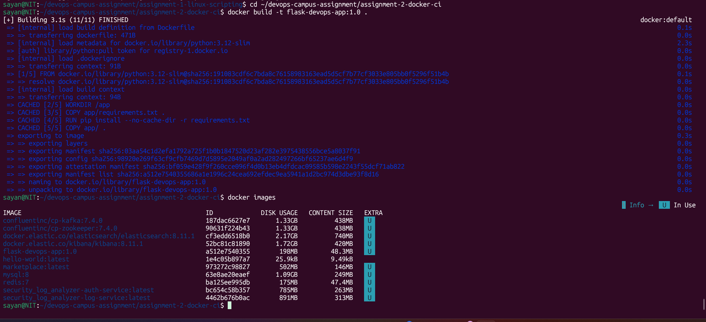
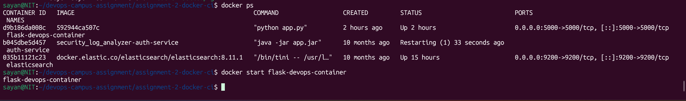
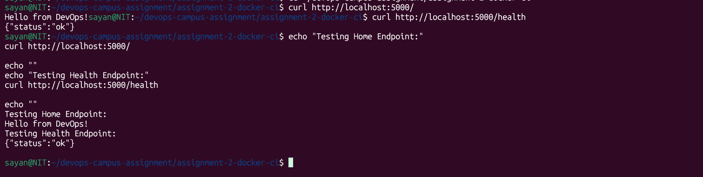
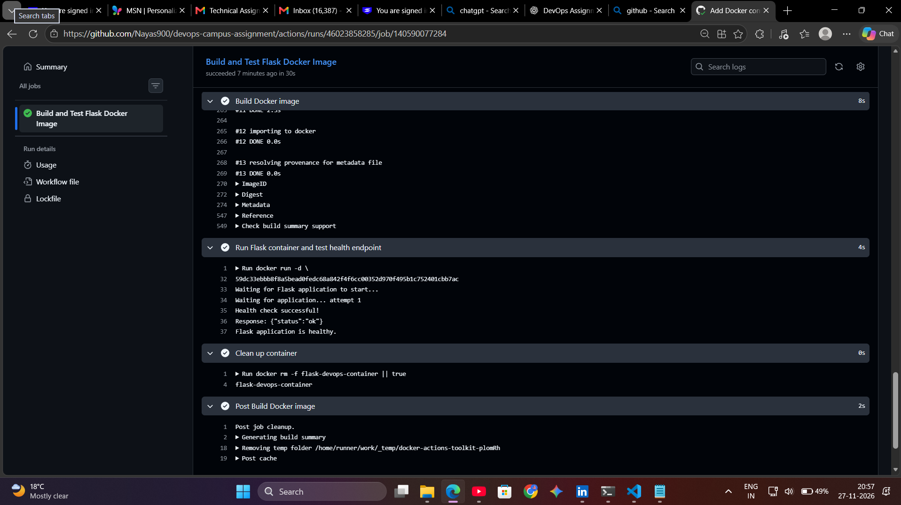

# Assignment 2: Dockerizing a Flask Application with CI

## 1. Objective

The objective of this assignment is to containerize a simple Python Flask application using Docker and configure a GitHub Actions workflow to automatically build the Docker image whenever code is pushed to the repository.

The assignment also involves identifying and fixing errors in a Dockerfile and Docker run command provided by a teammate.

## 2. Technologies Used

- Python 3
- Flask
- Docker
- Dockerfile
- Git and GitHub
- GitHub Actions
- GitHub Actions CI/CD

## 3. Project Structure

```text
assignment-2-docker-ci/
├── app/
│   ├── app.py
│   └── requirements.txt
├── Dockerfile
├── .dockerignore
└── README.md
```

## 4. Flask Application

The application contains two endpoints:

### Home Endpoint

```python
@app.route("/")
def home():
    return "Hello from DevOps!"
```

### Health-check Endpoint

```python
@app.route("/health")
def health():
    return {"status": "ok"}
```

The application runs on port `5000` and binds to `0.0.0.0` so that it can receive requests from outside the Docker container.

## 5. Docker Configuration

The Dockerfile performs the following operations:

1. Uses the lightweight Python 3.12 slim base image.
2. Sets `/app` as the working directory.
3. Copies the requirements file into the container.
4. Installs Flask and its dependencies.
5. Copies the application source code into the container.
6. Exposes port `5000`.
7. Starts the Flask application.

### Dockerfile

```dockerfile
FROM python:3.12-slim

WORKDIR /app

COPY app/requirements.txt .

RUN pip install --no-cache-dir -r requirements.txt

COPY app/ .

EXPOSE 5000

CMD ["python", "app.py"]
```

### .dockerignore

The `.dockerignore` file excludes unnecessary files from the Docker build context.

```text
.git
.gitignore
__pycache__
*.pyc
.venv
venv
.env
```

This helps keep the Docker build context clean and avoids copying unnecessary files into the image.

## 6. Build the Docker Image

Run the following command from the `assignment-2-docker-ci` directory:

```bash
docker build -t flask-devops-app:1.0 .
```

The image was successfully created with the tag:

```text
flask-devops-app:1.0
```

Verify the image:

```bash
docker images
```

## 7. Run the Docker Container

Start the container in detached mode:

```bash
docker run -d --name flask-devops-container -p 5000:5000 flask-devops-app:1.0
```

Explanation:

- `-d` runs the container in the background.
- `--name` assigns a name to the container.
- `-p 5000:5000` maps host port 5000 to container port 5000.

Verify that the container is running:

```bash
docker ps
```

## 8. Test the Application

### Test the Home Endpoint

Command:

```bash
curl http://localhost:5000/
```

Expected output:

```text
Hello from DevOps!
```

### Test the Health Endpoint

Command:

```bash
curl http://localhost:5000/health
```

Expected output:

```json
{"status":"ok"}
```

Both endpoints were tested successfully and returned HTTP status code `200`.

## 9. Container Logs

To inspect application logs:

```bash
docker logs flask-devops-container
```

The logs confirmed that Flask started successfully and handled requests to `/` and `/health`.

## 10. Stop and Remove the Container

Stop the running container:

```bash
docker stop flask-devops-container
```

Remove the container:

```bash
docker rm flask-devops-container
```

## 11. GitHub Actions CI

A GitHub Actions workflow is configured in:

```text
.github/workflows/build.yml
```

The workflow is triggered automatically on:

- Every push to the repository.
- Pull requests.

### CI Workflow Operations

The workflow performs the following operations:

1. Checks out the repository code.
2. Sets up Docker Buildx.
3. Builds the Flask Docker image using the Assignment 2 Dockerfile.
4. Loads the built Docker image into the GitHub Actions runner.
5. Starts a Docker container using the newly built image.
6. Tests the Flask application's `/health` endpoint using `curl`.
7. Retries the health check if the application needs additional time to start.
8. Verifies that the endpoint returns the expected response: `{"status":"ok"}`.
9. Stops and removes the test container, even if the health check fails.

### Automated Health Check

The workflow tests the application using:

```bash
curl --fail --silent http://localhost:5000/health
```

Expected response:

```json
{"status":"ok"}
```

If the application starts successfully and returns the expected response, the health check passes.

If the application fails to start, the endpoint is unavailable, or the response is unexpected, the GitHub Actions workflow fails and displays the container logs for troubleshooting.

### CI Execution

The workflow builds and tests the Docker image locally within the GitHub Actions runner. Pushing the image to an external Docker registry is not required.

The complete CI pipeline was executed and verified successfully through the GitHub Actions tab.

## 12. Conclusion

Successfully containerized and executed a Python Flask application using Docker.

Built the Docker image, ran the container, and verified both application endpoints through HTTP requests.

Identified and fixed the errors in the provided Dockerfile and Docker run command.

Configured GitHub Actions to automatically build the Docker image whenever code is pushed or a pull request is created.

Enhanced the CI pipeline with an automated container health check that starts the application, tests the `/health` endpoint, validates the response, and cleans up the container.

Also implemented a `.dockerignore` file to exclude unnecessary files from the Docker build context.

The Docker deployment and automated CI pipeline were tested successfully.

## 13. Debugging and Troubleshooting

The recruitment team provided a Dockerfile and Docker run command containing errors that could prevent the Flask application from building or being accessed.

I analyzed the provided configuration, identified the problems, and documented their fixes below.

### 13.1 Incorrect Base Image Instruction

**Problem:**

```dockerfile
FORM python:3.12-slim
```

**Fix:**

```dockerfile
FROM python:3.12-slim
```

**Explanation:**

`FROM` is the valid Dockerfile instruction used to specify the base image.

`FORM` is an invalid Dockerfile instruction and causes the Docker image build to fail.

### 13.2 Incorrect Requirements Filename

**Problem:**

```dockerfile
RUN pip install -r requirement.txt
```

**Fix:**

```dockerfile
RUN pip install -r requirements.txt
```

**Explanation:**

The provided dependency file is named `requirements.txt`, not `requirement.txt`.

Using the incorrect filename causes a file-not-found error during the Docker build.

### 13.3 Incorrect Docker Port Mapping

**Problem:**

```bash
docker run -p 5000:8080 myapp
```

**Fix:**

```bash
docker run -p 5000:5000 myapp
```

**Explanation:**

The Flask application listens on port `5000` inside the container.

Docker port mapping follows this format:

```text
HOST_PORT:CONTAINER_PORT
```

The incorrect command maps host port `5000` to container port `8080`, where the Flask application is not listening.

The correct mapping is `5000:5000`.

### 13.4 Incorrect Application File Copying

**Problem:**

```dockerfile
COPY . .
CMD ["python", "app.py"]
```

**Explanation:**

In this project, the Docker build context is the Assignment 2 root directory, and the Flask source code is stored inside the `app/` directory.

Using `COPY . .` copies the `app/` directory into the container's working directory.

As a result, `app.py` is located at `/app/app/app.py`, while the startup command expects it at `/app/app.py`.

This can cause the container to fail during startup.

**Fix:**

```dockerfile
COPY app/ .
```

This copies the contents of the application directory directly into the container's working directory.

### 13.5 Final Corrected Dockerfile

After fixing the identified issues, the final Dockerfile used in this project is:

```dockerfile
FROM python:3.12-slim

WORKDIR /app

COPY app/requirements.txt .

RUN pip install --no-cache-dir -r requirements.txt

COPY app/ .

EXPOSE 5000

CMD ["python", "app.py"]
```

The application is started using:

```bash
docker run -d --name flask-devops-container -p 5000:5000 flask-devops-app:1.0
```

### 13.6 Verification After Fixing the Issues

After correcting the Docker configuration, I successfully built the Docker image, started the container, and tested both Flask endpoints.

**Home endpoint:**

```bash
curl http://localhost:5000/
```

Output:

```text
Hello from DevOps!
```

**Health endpoint:**

```bash
curl http://localhost:5000/health
```

Output:

```json
{"status":"ok"}
```

Both endpoints returned successful HTTP responses, confirming that the Flask application was accessible through the Docker container.

## 14. Screenshots

The following screenshots provide evidence of the successful Docker deployment, Flask API testing, and GitHub Actions CI execution.

### 1. Docker Image Build

Shows the successful creation of the Flask Docker image.



### 2. Running Docker Container

Shows the Flask application running inside a Docker container with the required port mapping.



### 3. Flask API Testing

Shows successful responses from both the home endpoint (`/`) and health endpoint (`/health`).



### 4. GitHub Actions CI Success

Shows the successful execution of the automated Docker build workflow on GitHub Actions.


